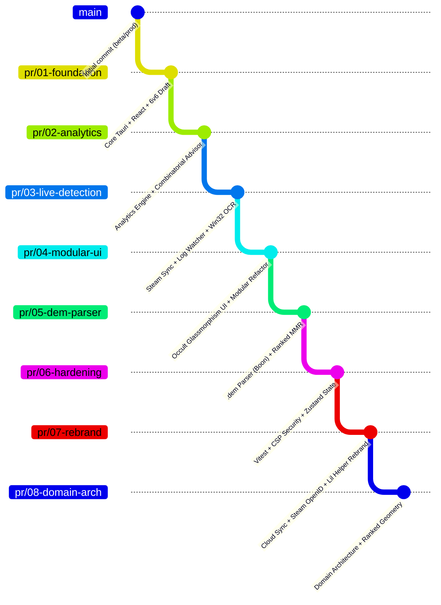

# 🚀 Lil Helper — Plan de Déploiement par Stacked PRs (Méthode Chaînée)

Ce document formalise la stratégie de rejeu de l'historique de **Lil Helper** sous la forme de **8 Pull Requests chaînées ("Stacked PRs")** depuis le commit initial (`beta`) jusqu'à l'architecture finale actuelle (`dev`).

---

## 🎯 Pourquoi la Méthode Chaînée (Stacked PRs) ?

1. **Diffs Isolés & Lisibles pour CodeRabbit** : Chaque PR a pour branche de base la PR précédente (`pr/02` pointe sur `pr/01`, `pr/03` sur `pr/02`, etc.). CodeRabbit n'analyse donc **que le delta strict** du jalon en cours, sans être pollué par l'historique antérieur.
2. **0 Conflit de Rebase** : Chaque branche pointe exactement sur un commit réel déjà présent dans l'historique linéaire de `dev`.
3. **Revue Pédagogique** : Permet à la communauté ou aux relecteurs de suivre pas à pas la construction de l'application (du MVP jusqu'au système complet).
4. **Déploiement en Cascade** : Dès que les 8 PRs sont validées par CodeRabbit, elles peuvent être fusionnées séquentiellement dans `beta`, puis `beta` dans `prod`.



---

## 📋 Tableau Synthétique des 8 PRs

| N° | Branche Source (Head) | Branche Cible (Base) | Commit Jalon | Périmètre Fonctionnel |
|:---|:---|:---|:---|:---|
| **#1** | `pr/01-foundation-and-match-logging` | `beta` | `6ceb019` | Socle Tauri v2, Catalogue des héros, Modèles de données & Saisie 6v6 |
| **#2** | `pr/02-analytics-and-draft-engine` | `pr/01-foundation-and-match-logging` | `04dba74` | Moteur d'analytics (matchups, synergies, lanes) & Optimiseur de draft |
| **#3** | `pr/03-live-detection-ocr-and-api-sync` | `pr/02-analytics-and-draft-engine` | `9fde77d` | Sync API Deadlock, Watcher `console.log` Source 2 & OCR Win32 |
| **#4** | `pr/04-modular-refactor-and-glassmorphism-ui` | `pr/03-live-detection-ocr-and-api-sync` | `2a30a8c` | Refonte UI Occult Liquid Glass, seuil 5/10 parties & modularisation |
| **#5** | `pr/05-dem-parser-ranked-and-draft-ux` | `pr/04-modular-refactor-and-glassmorphism-ui` | `44823e6` | Parser natif `.dem` (Boon), calculateur Ranked MMR & UX draft |
| **#6** | `pr/06-testing-security-and-zustand-state` | `pr/05-dem-parser-ranked-and-draft-ux` | `970d77f` | Suite Vitest, durcissement CSP Tauri, stores Zustand & migrations JSON |
| **#7** | `pr/07-cloud-sync-steam-auth-and-rebrand` | `pr/06-testing-security-and-zustand-state` | `ee6997f` | Sync Cloud Supabase, Steam OpenID 2.0 & Rebranding officiel **Lil Helper** |
| **#8** | `pr/08-domain-architecture-and-ranked-chart` | `pr/07-cloud-sync-steam-auth-and-rebrand` | `0caf3d5` | Architecture par domaines métier, graphique de progression Ranked & cleanup |

---

## 🔍 Détail & Spécifications des Pull Requests

---

### PR #1 — Core Foundation, Hero Registry & Match Logging
* **Head Branch** : `pr/01-foundation-and-match-logging`
* **Base Branch** : `beta`
* **Milestone Commit** : `6ceb019` *(7 commits)*
* **Titre PR** : `feat(core): initialize Tauri v2 architecture, hero catalog, and manual 6v6 match logging`
* **Périmètre** :
  * Initialisation du runtime Tauri v2 (Rust 2021) avec frontend React 19, TypeScript et Tailwind CSS 4.
  * Registre statique des 35 héros (`src/data/heroes.ts`) et intégration des portraits WebP officiels.
  * Modèles de domaine (`MatchRecord`, `Side`, `MatchResult`, `LaneColor`) et moteur de persistance JSON atomique en Rust (`src-tauri/src/storage.rs`).
  * Interface de saisie rapide 6v6 (`MatchForm`) avec sélection visuelle des héros (`HeroPicker`), avatars et historique éditable (`HistoryList`).
* **Focus Relecteur / CodeRabbit** :
  * Typage strict TypeScript des structures de match et validation côté client/Rust.
  * Gestion défensive des erreurs I/O sur le stockage fichier local.

---

### PR #2 — Analytics Engine & Combinatorial Draft Advisor
* **Head Branch** : `pr/02-analytics-and-draft-engine`
* **Base Branch** : `pr/01-foundation-and-match-logging`
* **Milestone Commit** : `04dba74` *(6 commits)*
* **Titre PR** : `feat(analytics): implement personal matchup matrix, lane conversion stats, and draft optimizer`
* **Périmètre** :
  * Tableau de bord de statistiques globales (winrate global hors matchs annulés, héros les plus joués).
  * Matrice de confrontations directes : détection des *Nemeses* (pires compteurs) et des synergies alliées optimales.
  * Calcul de performance par lane (Yellow, Blue, Green) avec taux de conversion lane gagnée $\rightarrow$ victoire finale.
  * Assistant de draft en direct : évaluation combinatoire des configurations 6v6, recommandations de contre-picks et suggestions de *lane swaps*.
* **Focus Relecteur / CodeRabbit** :
  * Algorithme combinatoire du draft advisor : vérification des cas limites (swaps cycliques, compositions partielles).
  * Précision arithmétique des calculs de winrate et exclusion stricte des matchs annulés.

---

### PR #3 — Steam API Sync, Source 2 Log Watcher & Screen OCR
* **Head Branch** : `pr/03-live-detection-ocr-and-api-sync`
* **Base Branch** : `pr/02-analytics-and-draft-engine`
* **Milestone Commit** : `9fde77d` *(13 commits)*
* **Titre PR** : `feat(detection): integrate Deadlock REST API sync, Source 2 console log watcher, and Win32 OCR engine`
* **Périmètre** :
  * Client REST Deadlock API (`deadlockApi.ts`) : synchronisation de profil Steam par Vanity URL/ID, filtrage des matchs classés et règle des 12 min de lane.
  * Log Watcher multi-disques (`log_watcher.rs`) : détection automatique du fichier `console.log` de Deadlock (`-condebug`), extraction du match ID, héros assigné et état du joueur (In Game / Hideout).
  * Pipeline OCR Win32 (`screen_ocr.rs`) : capture de la fenêtre de jeu sans injection mémoire (100% VAC-Safe) et reconnaissance optique Tesseract.js avec distance de Levenshtein pour les noms de héros.
  * Durcissement de la persistance : écritures atomiques avec renommage temp, sauvegardes `.bak` automatiques et thread-safety `Mutex`.
* **Focus Relecteur / CodeRabbit** :
  * **Sécurité VAC** : Aucune injection de mémoire ni hook DirectX ; stricte lecture passive des logs et capture d'écran OS.
  * Robustesse de la détection de fenêtre Win32 (exclusion des fenêtres tierces).

---

### PR #4 — Modular Architecture Refactoring & Occult Glassmorphism UI
* **Head Branch** : `pr/04-modular-refactor-and-glassmorphism-ui`
* **Base Branch** : `pr/03-live-detection-ocr-and-api-sync`
* **Milestone Commit** : `2a30a8c` *(17 commits)*
* **Titre PR** : `refactor(ui): redesign glassmorphic occult interface, statistical representativeness, and modular domain split`
* **Périmètre** :
  * Découpage du service monolithique d'analytics en modules indépendants (`global`, `matchups`, `lanes`, `draftRecommendations`, `draftAdvisor`).
  * Règle de représentativité statistique (règle des 5/10 matchs) pour éviter de biaiser les conseils de draft sur des échantillons trop faibles.
  * Suivi des séries de victoires/défaites (*streaks*) et des visages familiers (*familiar faces*).
  * Refonte visuelle majeure : esthétique Art Déco / Occulte / Liquid Glass, fonds d'écran dynamiques par héros et typographies contrastées adaptées au 2K.
* **Focus Relecteur / CodeRabbit** :
  * Optimisation des performances React : mémoïsation (`useMemo`, `useCallback`) sur les calculs statistiques lourds.
  * Découplage propre des sous-composants d'en-tête et du hook `useProfileSync`.

---

### PR #5 — `.dem` Replay Parser (Boon), Ranked MMR Engine & Draft UX
* **Head Branch** : `pr/05-dem-parser-ranked-and-draft-ux`
* **Base Branch** : `pr/04-modular-refactor-and-glassmorphism-ui`
* **Milestone Commit** : `44823e6` *(12 commits)*
* **Titre PR** : `feat(ranked): add native .dem replay parser via Boon, subrank shield indicators, and draft session persistence`
* **Périmètre** :
  * Intégration du crate Rust `boon-deadlock` pour parser les replays Source 2 (`.dem`) en local quand l'API externe est indisponible (HTTP 429).
  * Calculateur de progression Ranked MMR : calcul des sous-rangs, système d'indicateurs de boucliers configurables et gestion des annulations AFK.
  * Améliorations Draft : panneau de bans flottant, disposition par duos de lanes (Yellow/Blue/Green) et persistance d'état inter-onglets via `useDraftSession`.
* **Focus Relecteur / CodeRabbit** :
  * Gestion de la mémoire lors de la désérialisation des fichiers volumineux `.dem` en Rust.
  * Précision mathématique du calcul des paliers de rang et des seuils de boucliers.

---

### PR #6 — Quality Assurance, Security CSP, Zustand Stores & Storage Migrations
* **Head Branch** : `pr/06-testing-security-and-zustand-state`
* **Base Branch** : `pr/05-dem-parser-ranked-and-draft-ux`
* **Milestone Commit** : `970d77f` *(10 commits)*
* **Titre PR** : `feat(state): migrate to Zustand stores, Vitest testing suite, strict CSP, and schema migrations`
* **Périmètre** :
  * Configuration de **Vitest** : mise en place de suites de tests unitaires complètes pour la validation, les calculs de rang, le stockage et l'OCR (120+ tests).
  * Durcissement de la sécurité : Content Security Policy (CSP) stricte dans `tauri.conf.json`.
  * Centralisation de l'état global avec **Zustand** (`useMatchStore`, `useUIStore`), éliminant tout prop drilling.
  * Moteur de cache pour l'analytics avec invalidation par empreinte digitale (*fingerprint*).
  * Versionnage du schéma de base de données locale (`storageMigration.ts`), migrations ascendantes et isolation multi-comptes Steam.
* **Focus Relecteur / CodeRabbit** :
  * Couverture de tests unitaires et assertions des cas nominaux et d'erreur.
  * Sécurité CSP Tauri (absence de directives laxistes) et intégrité des migrations de données utilisateur.

---

### PR #7 — Cloud Sync (Supabase), Steam OpenID Auth & Lil Helper Rebrand
* **Head Branch** : `pr/07-cloud-sync-steam-auth-and-rebrand`
* **Base Branch** : `pr/06-testing-security-and-zustand-state`
* **Milestone Commit** : `ee6997f` *(5 commits)*
* **Titre PR** : `feat(rebrand): implement Supabase cloud sync, Steam OpenID 2.0 flow, and official Lil Helper rebrand`
* **Périmètre** :
  * Synchronisation Cloud optionnelle via Supabase avec fallback Row Level Security (RLS) et serveur proxy local pour protéger les requêtes.
  * Flux d'authentification officiel **Steam OpenID 2.0** (`api/auth/steam/`) avec redirection automatique vers le client desktop.
  * Bannière de téléchargement desktop non-intrusive pour les clients web.
  * **Rebranding complet en Lil Helper** : mise en place de la mascotte du familier de Rem (icône sorcier), génération des assets multi-formats (Windows, macOS, iOS, Android) et purge intégrale des clés secrètes dans Git.
* **Focus Relecteur / CodeRabbit** :
  * Respect des règles de sécurité des secrets (0 clé en dur dans le code source).
  * Conformité du flux OpenID Steam et validation des callbacks.

---

### PR #8 — Clean Domain Architecture & Ranked Progression Geometry
* **Head Branch** : `pr/08-domain-architecture-and-ranked-chart`
* **Base Branch** : `pr/07-cloud-sync-steam-auth-and-rebrand`
* **Milestone Commit** : `0caf3d5` *(12 commits)*
* **Titre PR** : `refactor(arch): organize modular domain architecture, ranked progression chart geometry, and cleanup`
* **Périmètre** :
  * Extraction et optimisation géométrique du service de graphique Ranked (`rankedChart.ts`) avec support d'une fenêtre glissante et vue globale.
  * Configuration centralisée de l'application (`appConfig.ts`), éliminant tous les nombres magiques.
  * Restructuration par domaines métier des services (`src/services/api/`, `draft/`, `history/`, `ranked/`, `storage/`) et des vues (`src/components/`).
  * Nettoyage du code mort et mise à jour de la documentation d'architecture (`GEMINI.md`, `README.md`).
* **Focus Relecteur / CodeRabbit** :
  * Structure finale des imports et respect de l'isolation des domaines.
  * Robustesse mathématique des projections SVG du graphique de progression.

---

## 🛠️ Guide d'Exécution Pas-à-Pas (Commandes Git & GitHub CLI)

### Étape 1 : Créer localement les 8 branches jalons
Ouvrez votre terminal dans `C:\dev\lil-helper` et exécutez ces commandes :

```powershell
# Positionnement sur le dépôt
cd C:\dev\lil-helper

# Création des 8 branches sur les commits jalons
git branch pr/01-foundation-and-match-logging        6ceb01996afaeabafae71f9b844ffa4c5cc5fb69
git branch pr/02-analytics-and-draft-engine         04dba7421aa20a958b3663c346bb5a906cc4561d
git branch pr/03-live-detection-ocr-and-api-sync   9fde77da5fa514d2c6d4a54ab28c05b255c5c8cc
git branch pr/04-modular-refactor-and-glassmorphism 2a30a8c83a009b7de94a6faa1ea5297b58531706
git branch pr/05-dem-parser-ranked-and-draft-ux     44823e6bdfcc2eec6df749a45a74dc15f4c0a4b8
git branch pr/06-testing-security-and-zustand-state 970d77f6c21d29fcdc215d444f833a10ad3a6fd2
git branch pr/07-cloud-sync-steam-auth-and-rebrand  ee6997f381501f9efbeffd0d4c1f67015504d2a3
git branch pr/08-domain-architecture-and-ranked-chart 0caf3d5b569acd5a753d5034233b8566a322710d
```

### Étape 2 : Pousser toutes les branches sur GitHub
```powershell
git push origin `
  pr/01-foundation-and-match-logging `
  pr/02-analytics-and-draft-engine `
  pr/03-live-detection-ocr-and-api-sync `
  pr/04-modular-refactor-and-glassmorphism `
  pr/05-dem-parser-ranked-and-draft-ux `
  pr/06-testing-security-and-zustand-state `
  pr/07-cloud-sync-steam-auth-and-rebrand `
  pr/08-domain-architecture-and-ranked-chart
```

### Étape 3 : Ouvrir les 8 PRs chaînées via la CLI GitHub (`gh`)
*(Alternative : vous pouvez aussi le faire depuis l'interface GitHub en sélectionnant bien la branche **base** indiquée ci-dessous).*

```powershell
# PR #1 (Base: beta)
gh pr create --base beta --head pr/01-foundation-and-match-logging `
  --title "feat(core): initialize Tauri v2 architecture, hero catalog, and manual 6v6 match logging" `
  --body "Milestone 1/8: Core setup, hero data, atomic storage, and 6v6 match form."

# PR #2 (Base: PR 1)
gh pr create --base pr/01-foundation-and-match-logging --head pr/02-analytics-and-draft-engine `
  --title "feat(analytics): implement personal matchup matrix, lane conversion stats, and draft optimizer" `
  --body "Milestone 2/8: Global stats, nemeses, ally synergies, lane gauges, and draft advisor."

# PR #3 (Base: PR 2)
gh pr create --base pr/02-analytics-and-draft-engine --head pr/03-live-detection-ocr-and-api-sync `
  --title "feat(detection): integrate Deadlock REST API sync, Source 2 console log watcher, and Win32 OCR engine" `
  --body "Milestone 3/8: Profile sync, Source 2 console monitoring, Win32 window capture, and Tesseract OCR."

# PR #4 (Base: PR 3)
gh pr create --base pr/03-live-detection-ocr-and-api-sync --head pr/04-modular-refactor-and-glassmorphism `
  --title "refactor(ui): redesign glassmorphic occult interface, statistical representativeness, and modular domain split" `
  --body "Milestone 4/8: Analytics domain decoupling, 5/10 representativeness rule, and occult liquid glass redesign."

# PR #5 (Base: PR 4)
gh pr create --base pr/04-modular-refactor-and-glassmorphism --head pr/05-dem-parser-ranked-and-draft-ux `
  --title "feat(ranked): add native .dem replay parser via Boon, subrank shield indicators, and draft session persistence" `
  --body "Milestone 5/8: Offline .dem replay parsing, ranked MMR calculator, shield badges, and draft session hook."

# PR #6 (Base: PR 5)
gh pr create --base pr/05-dem-parser-ranked-and-draft-ux --head pr/06-testing-security-and-zustand-state `
  --title "feat(state): migrate to Zustand stores, Vitest testing suite, strict CSP, and schema migrations" `
  --body "Milestone 6/8: 120+ unit tests with Vitest, strict CSP headers, Zustand global state, and storage migrations."

# PR #7 (Base: PR 6)
gh pr create --base pr/06-testing-security-and-zustand-state --head pr/07-cloud-sync-steam-auth-and-rebrand `
  --title "feat(rebrand): implement Supabase cloud sync, Steam OpenID 2.0 flow, and official Lil Helper rebrand" `
  --body "Milestone 7/8: Supabase sync, Steam OpenID auth, multi-platform icons, and complete Lil Helper rebrand."

# PR #8 (Base: PR 7)
gh pr create --base pr/07-cloud-sync-steam-auth-and-rebrand --head pr/08-domain-architecture-and-ranked-chart `
  --title "refactor(arch): organize modular domain architecture, ranked progression chart geometry, and cleanup" `
  --body "Milestone 8/8: Final domain directory restructuring, SVG ranked progression chart, centralized config, and docs."
```

---

## 🏁 Procédure de Fusion (Après Revue CodeRabbit)

1. Dès que **CodeRabbit** a terminé l'analyse de chaque PR et que les retours sont validés :
2. Fusionnez la **PR #1** dans `beta` (via *Merge Commit* ou *Rebase & Merge*).
3. Sur GitHub, changez la branche base de la **PR #2** pour pointer vers `beta` (si GitHub ne le fait pas automatiquement), puis fusionnez-la.
4. Répétez l'opération en cascade jusqu'à la **PR #8**.
5. Une fois `beta` validée et testée à 100%, créez la PR finale `beta` $\rightarrow$ `prod` pour taguer la version **v0.1.0** !
